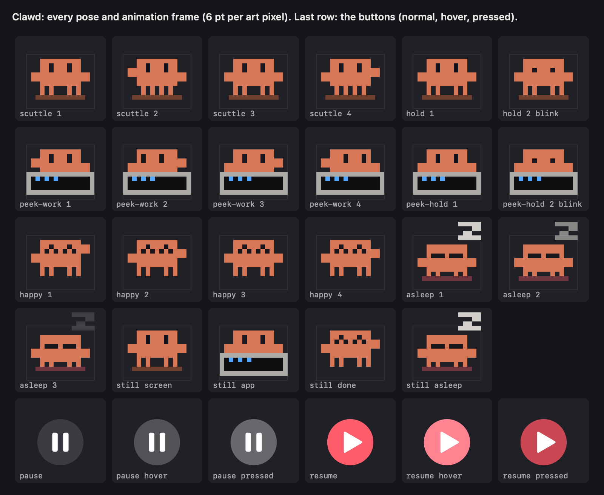

# screen-light

A small light on the right edge of your screen that shows when Claude has control of your Mac, with a pause button that stops Claude from using your screen until you say so.

## What you will see

The little pixel crab is Clawd, Claude Code's mascot. It changes with what Claude is doing. Every pose and frame, and the two buttons:

| Look | Meaning | What the crab does |
|---|---|---|
| **Orange**: "Claude has your screen" | Claude is using your whole screen, mouse and keyboard. Keep your hands off. | Scuttles while Claude acts, stands and blinks while it thinks. |
| **Blue**: "Claude is in Gemini" | Claude is working inside one app in the background. You can keep using your Mac. | Peeks over a little window. |
| **Green**: "Claude gave control back" | Shown for a few seconds when Claude lets go, finishes, or you stop it. | Waves, happy. |
| **Red**: "Screen control is paused" | You paused Claude. It stays paused until you resume. | Asleep. |
| **Green**: "Screen control is back on" | Shown for three seconds after you resume. | Waves, happy. |

The second line says what Claude is doing right now ("Opens the + menu in the prompt box"). The clock on the right counts how long this stretch of control (or this pause) has lasted. With several displays connected, the light shows on each one. If you have turned on "Reduce motion" in System Settings, the light does not slide and the crab keeps still.

The light slides in from the edge when Claude takes control and slides away when it lets go.

## The pause button

While Claude holds control, the light has a round button at its right end (two bars). Press it:

1. The light turns red and says "Screen control is paused". The button becomes a red Resume button (a play triangle).
2. Every screen tool Claude tries is refused. Claude is told to stop, say in one sentence that it is paused, and wait. Letting go of control is still allowed.
3. It stays paused until you press Resume on the light, or type `/screen-light resume`. Then tell Claude to carry on.

`/screen-light pause` does the same from the keyboard. Use it to pause before Claude starts, because the green notes have no button (Claude has already let go).

The light still cannot be clicked, apart from that one button. The button is its own small window on top of the light, so a click anywhere else on the light goes straight through to the app underneath. A second click within a second of the first is ignored, so a double-click cannot pause and then undo it.

**What the pause is, and is not.**

- It is a stop sign Claude is told to obey, not a lock. The mod refuses Claude's computer-use tools (the ones that work your screen) before they run, and the refusal tells Claude not to look for another way. It cannot stop Claude from using other tools, such as running commands.
- A step Claude has already started still finishes. The pause stops the next one.
- It only covers the computer-use tools on this Mac. A cloud session that drives your Mac from far away runs somewhere else, so a mod on this Mac does not see it or stop it.
- It is one pause for the whole Mac, not one per session.
- **Sessions that were already open when you updated Screen Light keep the old version until you restart them, and the old version does not know about the pause.** After updating, restart any Claude session you want the pause to work in.
- It stops on doubt. If the pause file (`~/.claude/screen-light/pause.json`) is damaged or cannot be read, Claude is stopped and the light shows red. Press Resume (or type `/screen-light resume`) and the file is rewritten.

## Try it

Type `/screen-light demo` in Claude. For about 13 seconds you get the three looks, one after the other. Nothing is being controlled, but the round button is real: if you press it during the demo, Claude really is paused until you press it again. While Claude is paused the demo plays nothing (it would only show red) and says so.

Commands: `/screen-light demo`, `/screen-light pause`, `/screen-light resume`, `/screen-light status` (is the light built and running? is Claude paused?), `/screen-light build` (build the program again), `/screen-light help`.

## How it works

1. **The mod** (`hooks/`) watches Claude's computer-use tools, the ones that let Claude work in other apps on your Mac. It tracks what each session holds and writes one small file per Claude session in `~/.claude/screen-light/state/`: whether Claude has the whole screen or one app, what it is doing, and when it started. Every one of these hooks ends with a fail-safe, so a bug in the light cannot refuse, change or repeat anything Claude does.
2. **The pause** is one more small file, `~/.claude/screen-light/pause.json`, written by the light's button and by `/screen-light pause` and `resume`. Before any computer-use call runs, the mod reads it. If it says paused (or cannot be understood), the call is refused with a plain-words message and never runs, except the two calls that let go of control (`release_full_control` and `app_release`). The pause check is the one part of the mod that fails closed (any doubt refuses); everything else fails open.
3. **The light program** (the Swift files in `app/`, built into `app/Screen Light.app`) reads those files four times a second and draws the light and the crab. The mod starts it the first time Claude takes control, or when a call is refused. It quits by itself after 20 minutes with nothing to show (never while the red look is up), and starts again when it is needed.

What counts as control, from Claude's real computer-use tools:

- The `app_*` tools (`app_click`, `app_type`, `app_screenshot`, `app_batch`, `open_application` and the rest) are **blue**: Claude works in one app, in the background. `app_release` ends it.
- `computer_batch`, `request_full_control` and the clipboard and display tools are **orange**: Claude has your whole screen. `release_full_control` ends it.
- Looking around (`list_apps`, `request_access`, the guided-tour tools) is not control, and the light stays dark. While paused these are refused too, because they are tools of the same set.
- A computer-use tool this mod has never heard of counts as orange (and is refused while paused): a light that comes on for nothing is a smaller mistake than one that stays dark while Claude has your mouse.
- When Claude's turn ends (it answers, or you press stop), control is over, because Claude cannot act any more. The light says so in green.

The Claude app already draws its own glowing border while Claude has full-screen control. The light adds what that border does not: it also shows the quiet background work, says which app and what Claude is doing, tells you when control comes back, and gives you the pause button.

## Where things are

- The mod and the light program: this folder, `~/claude-mods/screen-light/`. Do not move it (the mods list reads it from here).
- The light's files: `~/.claude/screen-light/state/` (one short description per session, like "Clicks the Send button"; the light program deletes any that are more than a day old) and `~/.claude/screen-light/pause.json`.
- The built program: `app/Screen Light.app`. It is not kept in the history (`.gitignore`): `app/build.sh` makes it from the Swift files, and the mod runs that by itself the first time a session starts without it. It needs the Mac's Command Line Tools (`xcode-select --install` gives you them). The program asks for no permissions.
- The Swift files: `main.swift` (start-up), `Model.swift` (what the light decides and the pause file), `Views.swift` (the windows, the button), `Crab.swift` (Clawd, drawn pixel by pixel), `Pictures.swift` (the review pictures and the test modes).

## Checks

From this folder:

- `claude plugin validate .` and `claude plugin test .` run the mod's engine tests.
- `python3 -B -m unittest discover -s app` runs the light program's tests: what it decides to show, the pause file, the button's press logic, the crab's pixels (build the program first).
- `python3 e2e/run_e2e.py` is an end-to-end check that needs no model: it runs the whole chain (the mod, the state and pause files, the real light program) against a fake computer-use server in a throwaway folder, and proves that a refused call never ran. The light flashes on your screen for a few seconds while it runs. It leaves your own `~/.claude/screen-light` alone.
- `"app/Screen Light.app/Contents/MacOS/ScreenLight" --snapshot looks.png all` draws all the looks into a picture (`sheet` draws every crab pose and the buttons).

## Honest limits (0.2.0, 6 Nov 2026)

- **Tested:** the mod's logic and its refusals with the real tool names and answer shapes (engine tests); what the light decides for every state and every kind of pause file, including damaged ones (program tests); the button's own press code, including a double-click, a release outside the button and a failed save; the window set-up of the real program (two windows per display, the pill ignoring the mouse, the button window the only clickable one); the crab pixel by pixel against the design; and the whole chain end to end with a fake computer-use server: a call runs and lights the light, `/screen-light pause` makes the next call refuse and never run, letting go still works while paused, `resume` lets calls run again, a damaged pause file stops calls and `resume` heals it, and a pause written the way the button writes it stops calls.
- **Not tested with a real computer-use session.** The session that built this has no computer-use tools. The first real use is the real test: if the light stays dark then, check `/screen-light status` and the `screen-light:` lines in `claude --debug`. (The end-to-end check uses a fake server under another name, because the engine reserves the name `computer-use`; the only difference in the mod it tested is that name.)
- **Not tried with a real mouse.** I could not post real clicks, so a real click on the real button (hover, press, the first click on a window that is not in front), the slide animation, and the pause wording while you point at the button were checked from the same code drawing the pictures, not by hand. The first press of the button is the first time a real finger is involved.
- Not tried, because this Mac has one display and no special settings: the light on each of several displays, "Reduce motion", a Dock on the right edge, and the 20-minute self-quit.
- It watches sessions that run on this Mac (the Claude desktop app's Code tab, and the terminal).
- macOS reports the light's window as not shareable, so it may be missing from screen recordings you make yourself.

## Installing, updating and uninstalling

- Install: `claude plugin install screen-light@hunter-mods --scope user` (the `hunter-mods` list is the folder `~/claude-mods`). From the private GitHub copy instead: `/plugin install screen-light --marketplace Syzia/claude-mods` (only works for someone who can read that repository). Then start a new Claude session; the light program builds itself the first time.
- Update: `claude plugin update screen-light@hunter-mods`, then restart your Claude sessions (see above: open sessions keep the old version). If an old light is still up on the screen, `pkill -x ScreenLight` closes it and the new one starts when needed.
- Uninstall: `claude plugin uninstall screen-light@hunter-mods`, then quit the light if it is up: `pkill -x ScreenLight`. If you uninstall it while paused, delete `~/.claude/screen-light/pause.json` too, so nothing is left that says paused.

## Changes

- **0.2.0** (6 Nov 2026): a pause button on the light and `/screen-light pause` and `resume`: while paused, Claude's computer-use tools are refused until you resume. The little guy is now Clawd, the crab (scuttling, peeking over a window, waving, asleep). A red look for the pause and a green note when you resume. The light program is now several Swift files. A reviewed build: five reviewers found nine possible problems, five were real (a double-click that paused and then un-paused, an older light taking the place of the new one, sessions started before the update not knowing about the pause, the demo clashing with a pause, and the sleeping crab's Z looking like an I), and they are fixed or said plainly above.
- **0.1.1** (6 Nov 2026): a session that never used the screen no longer leaves a small file behind when it ends (found when a real headless run left two). Checked live in a fresh Claude process: `/screen-light status` and `/screen-light demo` worked from the installed mod, wrote the file and started the real light.
- **0.1.0** (6 Nov 2026): first version.
