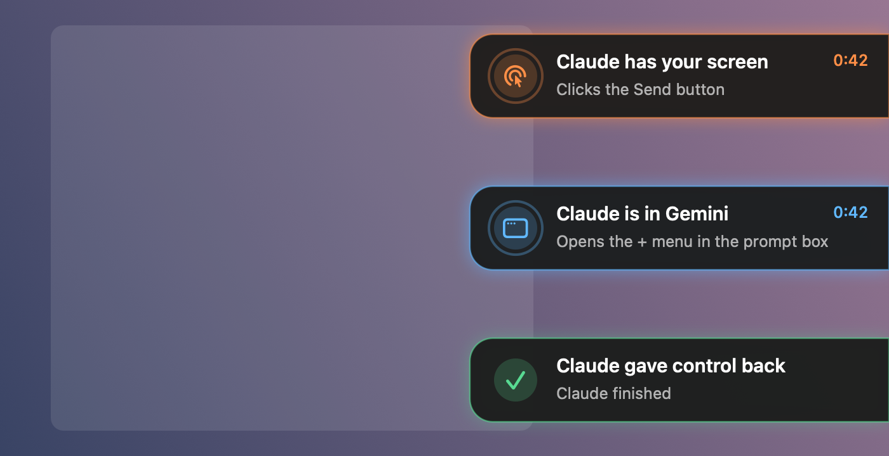

# screen-light

A small light on the right edge of your screen that shows when Claude has control of your Mac.

## What you will see

| Look | Meaning |
|---|---|
| **Orange**: "Claude has your screen" | Claude is using your whole screen, mouse and keyboard. Keep your hands off. |
| **Blue**: "Claude is in Gemini" | Claude is working inside one app in the background. You can keep using your Mac. |
| **Green**: "Claude gave control back" | Shown for a few seconds when Claude lets go, finishes, or you stop it. |

The second line says what Claude is doing right now ("Opens the + menu in the prompt box"). The clock on the right counts how long this stretch of control has lasted. The ring around the icon pulses fast while Claude is acting and slowly while it is thinking between steps. With several displays connected, the light shows on each one. If you have turned on "Reduce motion" in System Settings, it does not slide or pulse.

The light slides in from the edge when Claude takes control and slides away when it lets go. It cannot be clicked: every click goes straight through it to the app underneath, so you or Claude can never press it by accident. It never changes what Claude does or sees. It only watches.

## Try it

Type `/screen-light demo` in Claude. For about 13 seconds you get the three looks, one after the other. Nothing is being controlled; it is only a demo.

Other commands: `/screen-light status` (is the light built and running?), `/screen-light build` (build it again), `/screen-light help`.

## How it works

1. **The mod** (`hooks/`) watches Claude's computer-use tools, the ones that let Claude work in other apps on your Mac. It never touches a call or its answer: every hook ends with a fail-safe so a bug in the light cannot refuse, change or repeat anything Claude does.
2. It keeps one small file per Claude session in `~/.claude/screen-light/state/`. The file says whether Claude has the whole screen or one app, what it is doing, and when it started.
3. **The light program** (`app/ScreenLight.swift`, built into `app/Screen Light.app`) reads those files four times a second and draws the light. The mod starts it the first time Claude takes control. It quits by itself after 20 minutes with nothing to show, and starts again when it is needed.

What counts as control, from Claude's real computer-use tools:

- The `app_*` tools (`app_click`, `app_type`, `app_screenshot`, `app_batch`, `open_application` and the rest) are **blue**: Claude works in one app, in the background. `app_release` ends it.
- `computer_batch`, `request_full_control` and the clipboard and display tools are **orange**: Claude has your whole screen. `release_full_control` ends it.
- Looking around (`list_apps`, `request_access`, the guided-tour tools) is not control, and the light stays dark.
- A computer-use tool this mod has never heard of counts as orange: a light that comes on for nothing is a smaller mistake than one that stays dark while Claude has your mouse.
- When Claude's turn ends (it answers, or you press stop), control is over, because Claude cannot act any more. The light says so in green.

The Claude app already draws its own glowing border while Claude has full-screen control. The light adds what that border does not: it also shows the quiet background work, says which app and what Claude is doing, and tells you when control comes back.

## Where things are

- The mod and the light program: this folder, `~/claude-mods/screen-light/`. Do not move it (the mods list reads it from here).
- The light's state files: `~/.claude/screen-light/state/`. They hold only short descriptions like "Clicks the Send button". The light program deletes any that are more than a day old.
- The built program: `app/Screen Light.app`. It is not kept in the history (`.gitignore`): `app/build.sh` makes it, and the mod runs that by itself the first time a session starts without it. It needs the Mac's Command Line Tools (`xcode-select --install` gives you them). The program asks for no permissions.

## Checks

From this folder:

- `claude plugin validate .` and `claude plugin test .` run the mod's 69 engine tests.
- `python3 -B -m unittest discover -s app` runs 18 tests of what the light decides to show (build the program first).

## Honest limits (0.1.0, 6 Nov 2026)

- Tested: the mod's logic with the real tool names and real answer shapes taken from earlier sessions (69 engine tests); what the light shows for each state (18 tests); the program as a real window, started by `open`, reading the real state folder: it sits at the right edge of the screen, hands back and hides on time, and one launch only ever makes one light. A state file written by the mod's own code was fed to the program and it decided correctly.
- **Not yet tested with a real computer-use session.** The session that built this one has no computer-use tools. The first real use of Claude controlling an app is the real test: if the light stays dark then, the thing to check is `/screen-light status` and the log line `screen-light:` in `claude --debug`.
- It watches sessions that run on this Mac (the Claude desktop app's Code tab, and the terminal). A cloud session that drives your Mac from far away runs somewhere else, so a mod on this Mac does not see it.
- It is a light, not a switch: it cannot stop Claude. To stop Claude, use the stop button in the Claude app.
- macOS reports the light's window as not shareable, so it may be missing from screen recordings you make yourself.
- Written but not tried, because this Mac has one display and no special settings: the light on each of several displays, "Reduce motion", a Dock on the right edge, and the 20-minute self-quit.

## Uninstall

`claude plugin uninstall screen-light@hunter-mods`, then quit the light if it is up: `pkill -x ScreenLight`.

## Changes

- **0.1.0** (6 Nov 2026): first version.
